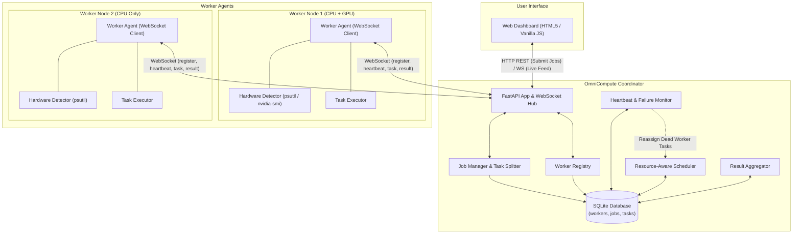

# OmniCompute Architecture Specification

## 1. System Overview

**OmniCompute** is a distributed computing system designed in Python to coordinate and harness idle CPU and GPU computational resources across multiple computers.

### Core Architecture Principles
1. **Central Coordinator**: Coordinates cluster state, stores metadata in SQLite, schedules compute tasks, collects task results, merges final job outputs, and serves real-time updates to a live web dashboard.
2. **Worker Agents**: Lightweight background processes running on cluster nodes. Each worker connects to the coordinator over a persistent WebSocket, advertises its hardware capabilities, sends periodic heartbeats, and executes designated tasks.
3. **Zero Arbitrary Code Execution**: For security, workers only execute strictly pre-defined, parameterized compute kernels. Raw Python or shell commands sent over the wire are rejected.
4. **Resilience & Fault Tolerance**: Heartbeat monitoring detects dead or degraded workers. Any active task assigned to a failed worker is reset to `pending` and rescheduled to an available worker.
5. **No Framework Overhead**: Coordinator uses FastAPI and WebSockets with SQLite; the web dashboard is pure HTML and vanilla JavaScript without external JS dependencies.

---

## 2. Mermaid Architecture Diagram



---

## 3. Directory and File Structure

```text
omnicompute/
│
├── shared/
│   ├── __init__.py
│   ├── protocol.py       # Pydantic schemas for all WebSocket & REST messages
│   └── config.py         # System defaults (ports, heartbeat timeouts, intervals)
│
├── coordinator/
│   ├── __init__.py
│   ├── main.py           # FastAPI server, REST routes, WebSocket endpoint
│   ├── db.py             # SQLite connection, schema initialization, CRUD operations
│   ├── registry.py       # Worker tracking, connection management
│   ├── monitor.py        # Background task detecting stale heartbeats & reassignment
│   ├── jobs.py           # Job creation, parameter validation, task partitioning
│   ├── scheduler.py      # Resource-aware scheduler matching tasks to workers
│   └── aggregator.py     # Merges completed task outputs per job type
│
├── worker/
│   ├── __init__.py
│   ├── agent.py          # WebSocket client connecting to coordinator
│   ├── hardware.py       # Detection of CPU cores, RAM, GPU via psutil / nvidia-smi / torch
│   ├── executor.py       # Task dispatcher executing built-in tasks
│   └── tasks/            # Built-in compute kernels
│       ├── __init__.py
│       ├── monte_carlo_pi.py
│       ├── prime_count.py
│       ├── matrix_multiply.py
│       └── ml_train.py
│
├── dashboard/
│   ├── index.html        # Single-page UI for jobs, cluster metrics, and live logs
│   └── app.js            # Vanilla JS WebSocket client and DOM updater
│
├── tests/                # Module test suites (test_m1 through test_m10)
│   └── conftest.py       # Shared fixtures: free_port, tmp_db
│
├── docs/
│   ├── ARCHITECTURE.md   # Architectural design and protocol reference
│   └── PROGRESS.md       # Implementation status checklist and notes
│
├── requirements.txt      # Python dependencies
├── pytest.ini            # Pytest configuration
├── run_tests.py          # Test runner script per module (python run_tests.py <N>)
└── README.md             # Project overview and getting started guide
```

---

## 4. Communication Protocol (JSON over WebSocket)

All communication between workers and the coordinator occurs over WebSocket connections via JSON messages validated against Pydantic schemas.

### 4.1. Worker Registration (`register`)
Sent by the worker upon establishing the WebSocket connection.
```json
{
  "type": "register",
  "worker_id": "worker-a1b2c3d4",
  "hostname": "node-01.local",
  "cpu_cores": 8,
  "ram_gb": 16.0,
  "gpu": {
    "name": "NVIDIA GeForce RTX 3080",
    "vram_gb": 10.0
  }
}
```
*Note: If no GPU is available, `"gpu": null`.*

### 4.2. Periodic Heartbeat (`heartbeat`)
Sent by the worker at regular intervals (e.g. every 2 seconds).
```json
{
  "type": "heartbeat",
  "worker_id": "worker-a1b2c3d4",
  "cpu_percent": 24.5,
  "ram_percent": 42.1,
  "gpu_percent": 65.0,
  "running_tasks": 1
}
```

### 4.3. Task Assignment (`task`)
Sent by the coordinator to dispatch a unit of work to a worker.
```json
{
  "type": "task",
  "task_id": "task-9876",
  "job_id": "job-1234",
  "task_type": "monte_carlo_pi",
  "payload": {
    "samples": 1000000,
    "seed": 42
  }
}
```

### 4.4. Task Result (`result`)
Sent by the worker back to the coordinator upon task completion or error.
```json
{
  "type": "result",
  "task_id": "task-9876",
  "status": "ok",
  "output": {
    "hits": 785412,
    "samples": 1000000
  },
  "duration_ms": 320.5
}
```
*In case of failure: `"status": "error"`, `"output": {"error": "Traceback or error message"}`.*

---

## 5. Built-in Job Types and Partitioning

To avoid security vulnerabilities associated with arbitrary remote code execution, OmniCompute executes only the following built-in job types:

| Job Type | Preferred Hardware | Partitioning Strategy | Aggregation / Merge Strategy |
| :--- | :--- | :--- | :--- |
| `monte_carlo_pi` | CPU | Total sample count `N` is partitioned into chunks of size `k` across `M` tasks. | $\pi \approx 4 \times \frac{\sum \text{hits}}{\sum \text{samples}}$ |
| `prime_count` | CPU | Overall range $[2, N]$ is divided into non-overlapping sub-intervals $[a_i, b_i]$. | $\text{Total Primes} = \sum \text{counts}$ |
| `matrix_multiply` | GPU (CPU fallback) | Computes $C = A \times B$. Matrix $A$ is partitioned into row blocks. Workers generate deterministic matrix data locally using shared seed and dimensions (avoiding heavy network I/O). | Row blocks $C_i$ are concatenated in order: $C = [C_1; C_2; \dots; C_k]$. |
| `ml_train` | GPU (CPU fallback) | Mini-batch SGD over synthetic/dataset shards. Each worker trains on a deterministic shard seed. | Model gradients / weights are combined via weighted average: $W = \sum \frac{n_i}{N} W_i$. |

---

## 6. Database Schema (SQLite)

The coordinator uses an SQLite database with WAL mode enabled to support concurrent read/write operations across background tasks and web requests.

### 6.1. `workers` Table
```sql
CREATE TABLE IF NOT EXISTS workers (
    id TEXT PRIMARY KEY,
    hostname TEXT NOT NULL,
    cpu_cores INTEGER NOT NULL,
    ram_gb REAL NOT NULL,
    gpu_name TEXT,
    vram_gb REAL,
    status TEXT NOT NULL CHECK(status IN ('alive', 'dead')),
    last_seen REAL NOT NULL,
    cpu_percent REAL DEFAULT 0.0,
    ram_percent REAL DEFAULT 0.0,
    gpu_percent REAL DEFAULT 0.0
);
```

### 6.2. `jobs` Table
```sql
CREATE TABLE IF NOT EXISTS jobs (
    id TEXT PRIMARY KEY,
    type TEXT NOT NULL,
    params TEXT NOT NULL,         -- JSON-serialized input parameters
    status TEXT NOT NULL CHECK(status IN ('pending', 'running', 'completed', 'failed')),
    created_at REAL NOT NULL,
    finished_at REAL,
    result TEXT                   -- JSON-serialized final merged output
);
```

### 6.3. `tasks` Table
```sql
CREATE TABLE IF NOT EXISTS tasks (
    id TEXT PRIMARY KEY,
    job_id TEXT NOT NULL REFERENCES jobs(id) ON DELETE CASCADE,
    payload TEXT NOT NULL,        -- JSON-serialized task-specific slice
    status TEXT NOT NULL CHECK(status IN ('pending', 'running', 'done', 'failed')),
    worker_id TEXT REFERENCES workers(id) ON DELETE SET NULL,
    attempts INTEGER DEFAULT 0,
    result TEXT,                  -- JSON-serialized task result
    started_at REAL,
    finished_at REAL
);
```

---

## 7. Fault Tolerance & Failure Handling

1. **Heartbeat Tracking**:
   - The coordinator monitor loop checks `last_seen` timestamps every second.
   - If `current_time - last_seen > HEARTBEAT_TIMEOUT` (e.g. 6 seconds), the worker status is updated to `'dead'`.
2. **Task Reassignment**:
   - Any task in `'running'` status assigned to a dead worker is reset to `'pending'`, incrementing its `attempts` counter.
   - If `attempts` exceeds `MAX_TASK_ATTEMPTS` (e.g. 3), the task is marked `'failed'`, which in turn transitions the parent job to `'failed'`.
3. **Worker Reconnection**:
   - If a dead worker reconnects, it re-registers and is updated to `'alive'`.

---

## 8. Resource-Aware Scheduler & Load Balancer

1. **Worker Eligibility**:
   - Worker must be `'alive'`.
   - Worker must have capacity (`running_tasks < max_concurrent_tasks_per_worker`).
2. **Affinity Rules**:
   - GPU-preferred tasks (`matrix_multiply`, `ml_train`) are prioritized for workers with available GPUs (`gpu_name IS NOT NULL` and low `gpu_percent`).
   - If no GPU worker is available or suitable, tasks fall back to available CPU workers.
3. **Load Balancing**:
   - Among eligible candidates, the worker with the lowest combined load score:
     $$\text{Score} = 0.6 \times \text{cpu\_percent} + 0.4 \times \text{ram\_percent}$$
     is chosen for CPU tasks.

